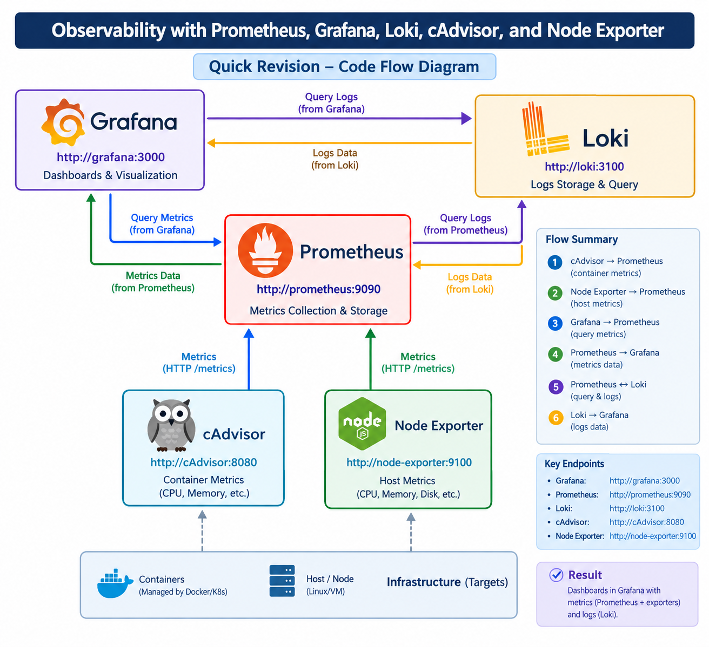
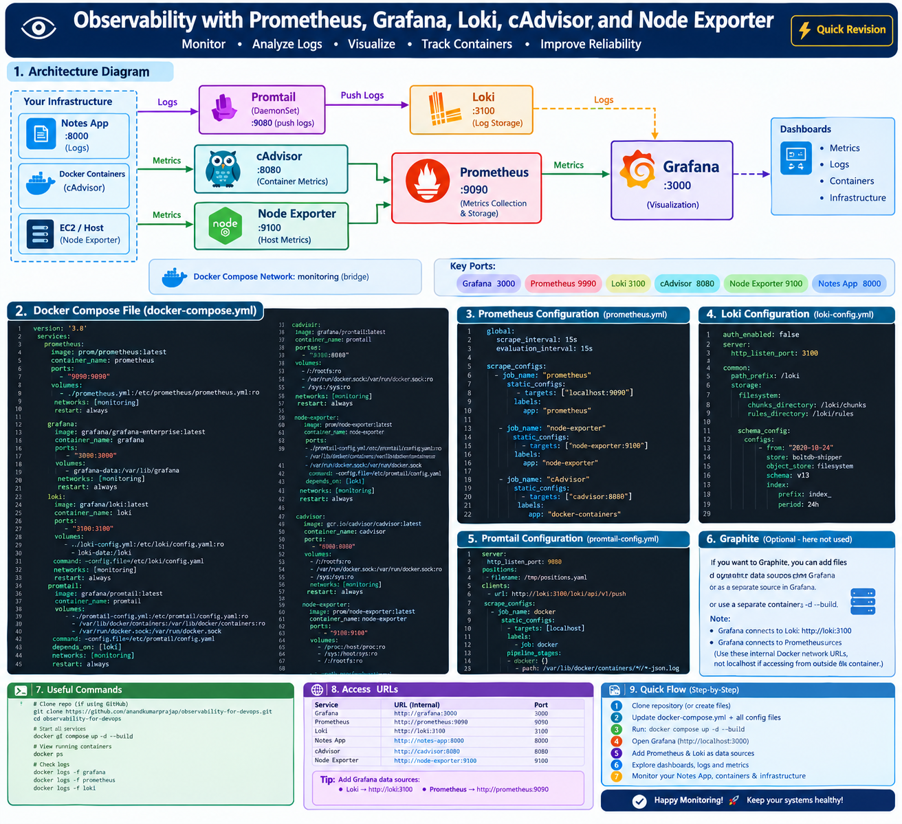
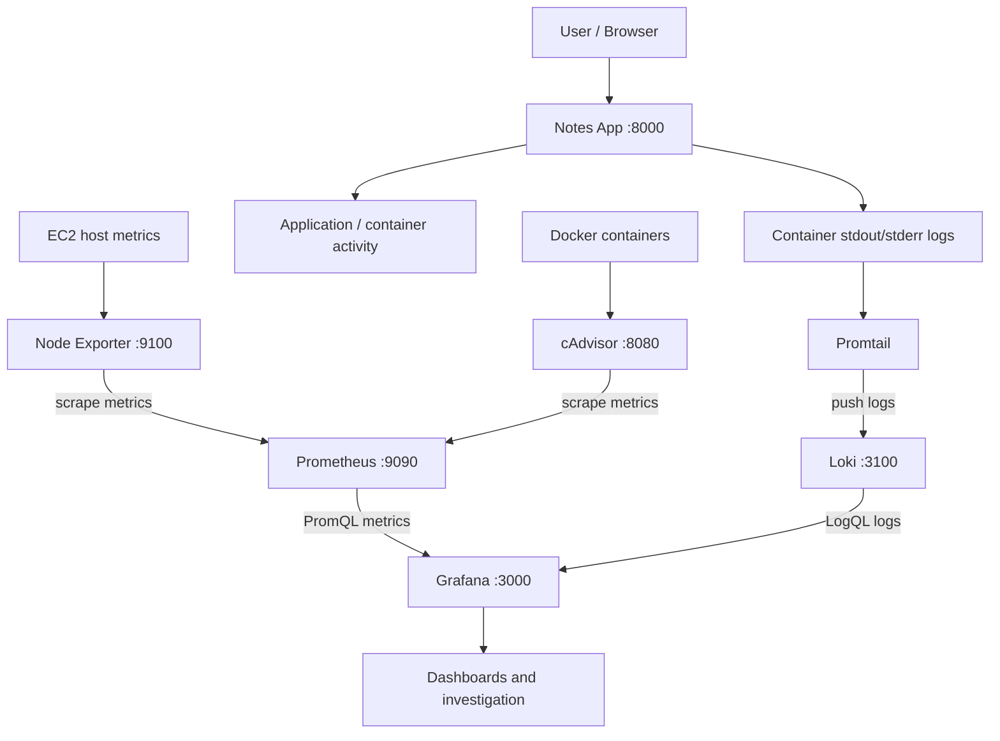

```image





```

## 1. What is observability?

**Observability** is the ability to understand a system's internal state from the outputs it produces—mainly metrics, logs, and traces.

- **Metrics:** numeric measurements over time, such as CPU usage, memory, request count, and latency.
- **Logs:** timestamped records of events and errors.
- **Traces:** follow a request across multiple services to help locate latency or failures.
- **Dashboards and alerts:** help engineers spot abnormal behavior and investigate incidents.

### Who uses it?

- **DevOps Engineer:** automates deployment, manages infrastructure, and integrates monitoring into delivery pipelines.
- **SRE (Site Reliability Engineer):** tracks service-level indicators, reliability, incidents, and alert quality.
- **Platform Engineer:** builds reusable infrastructure and self-service tooling for development teams.
- **Developer/QA Engineer:** investigates application errors, performance problems, and regressions.

## 2. Architecture diagram



### Data flow

1. **Node Exporter** exposes host-level metrics such as CPU, memory, disk, and network statistics.
2. **cAdvisor** exposes container resource metrics.
3. **Prometheus** scrapes metrics from configured targets and stores time-series data.
4. **Promtail** reads Docker container log files and sends them to Loki.
5. **Loki** indexes log labels and stores log data.
6. **Grafana** queries Prometheus with PromQL and Loki with LogQL, then visualizes both.
7. **Notes App** is the sample application to deploy and observe.

> Prometheus and Loki are different: Prometheus stores **metrics**, while Loki stores **logs**. Grafana visualizes both.

## 3. Project structure

Create or arrange the repository like this:

```text
observability-for-devops/
├── docker-compose.yml
├── prometheus.yml
├── loki/
│   └── loki-config.yml
├── promtail/
│   └── promtail-config.yml
├── grafana/
│   └── provisioning/              # optional: dashboard/data-source provisioning
└── notes-app/
    ├── Dockerfile
    ├── manage.py
    ├── requirements.txt
    └── ... Django application files ...
```

File and directory names must match the paths in `docker-compose.yml`. Linux paths are case-sensitive.

## 4. Install Docker Engine and Compose plugin (Ubuntu)

```bash
sudo apt-get update
sudo apt-get install -y docker.io docker-compose-v2
sudo systemctl enable --now docker
sudo usermod -aG docker "$USER"
newgrp docker

docker --version
docker compose version
```

If `docker-compose-v2` is unavailable in your Ubuntu repository, follow the official Docker Engine installation instructions for your Ubuntu release and install the Compose plugin. After changing group membership, log out and back in if `newgrp docker` does not update the current shell.

## 5. Clone the Notes App repository

Use your actual repository URL:

```bash
git clone https://github.com/OWNER/REPOSITORY.git notes-app
```

If the Notes App is already inside the observability repository, do **not** clone it over the existing folder. Instead, check it:

```bash
cd ~/observability-for-devops
ls
ls notes-app
```

The Compose configuration below assumes the app folder contains a valid `Dockerfile`, `requirements.txt`, and Django `manage.py`.

## 6. `docker-compose.yml`

Save the following at the repository root as `docker-compose.yml`. It defines the application and monitoring stack on one shared Docker network.

```yaml
name: observability-for-devops

services:
  notes-app:
    build:
      context: ./notes-app
      dockerfile: Dockerfile
    image: notes-app:latest
    container_name: notes-app
    restart: unless-stopped
    ports:
      - "8000:8000"
    networks:
      - monitoring

  prometheus:
    image: prom/prometheus:latest
    container_name: prometheus
    restart: unless-stopped
    command:
      - "--config.file=/etc/prometheus/prometheus.yml"
      - "--storage.tsdb.path=/prometheus"
      - "--web.console.libraries=/etc/prometheus/console_libraries"
      - "--web.console.templates=/etc/prometheus/consoles"
    volumes:
      - ./prometheus.yml:/etc/prometheus/prometheus.yml:ro
      - prometheus_data:/prometheus
    ports:
      - "9090:9090"
    networks:
      - monitoring

  node-exporter:
    image: prom/node-exporter:latest
    container_name: node-exporter
    restart: unless-stopped
    command:
      - "--path.procfs=/host/proc"
      - "--path.sysfs=/host/sys"
      - "--path.rootfs=/rootfs"
      - "--collector.filesystem.mount-points-exclude=^/(sys|proc|dev|host|etc)($$|/)"
    volumes:
      - /proc:/host/proc:ro
      - /sys:/host/sys:ro
      - /:/rootfs:ro
    ports:
      - "9100:9100"
    networks:
      - monitoring

  cadvisor:
    image: gcr.io/cadvisor/cadvisor:latest
    container_name: cadvisor
    restart: unless-stopped
    privileged: true
    devices:
      - /dev/kmsg
    volumes:
      - /:/rootfs:ro
      - /var/run:/var/run:ro
      - /sys:/sys:ro
      - /var/lib/docker/:/var/lib/docker:ro
      - /dev/disk/:/dev/disk:ro
    ports:
      - "8080:8080"
    networks:
      - monitoring

  loki:
    image: grafana/loki:latest
    container_name: loki
    restart: unless-stopped
    command:
      - "-config.file=/etc/loki/config.yaml"
    volumes:
      - ./loki/loki-config.yml:/etc/loki/config.yaml:ro
      - loki_data:/loki
    ports:
      - "3100:3100"
    networks:
      - monitoring

  promtail:
    image: grafana/promtail:latest
    container_name: promtail
    restart: unless-stopped
    command:
      - "-config.file=/etc/promtail/config.yml"
    volumes:
      - ./promtail/promtail-config.yml:/etc/promtail/config.yml:ro
      - /var/lib/docker/containers:/var/lib/docker/containers:ro
      - /var/run/docker.sock:/var/run/docker.sock:ro
    depends_on:
      - loki
    networks:
      - monitoring

  grafana:
    image: grafana/grafana-oss:latest
    container_name: grafana
    restart: unless-stopped
    ports:
      - "3000:3000"
    volumes:
      - grafana_data:/var/lib/grafana
    depends_on:
      - prometheus
      - loki
    networks:
      - monitoring

networks:
  monitoring:
    driver: bridge

volumes:
  prometheus_data:
  grafana_data:
  loki_data:
```

**Port map**

| Service | Host port | Purpose |
|---|---:|---|
| Notes App | `8000` | Sample Django application |
| Grafana | `3000` | Dashboards and data sources |
| Prometheus | `9090` | Metrics query UI |
| cAdvisor | `8080` | Container metrics UI |
| Node Exporter | `9100` | Host metrics endpoint |
| Loki | `3100` | Log API |
| Promtail | no published port | Ships logs to Loki |

The internal service URLs on the shared Docker network are `http://prometheus:9090` and `http://loki:3100`. Use those URLs in Grafana—not `localhost`, because `localhost` inside the Grafana container refers to Grafana itself.

> cAdvisor and Node Exporter need access to host information. Review their permissions and avoid exposing their ports publicly in a production environment. For safer access, remove their host `ports` entries and keep them reachable only inside the Compose network.

## 7. `prometheus.yml`

Create `prometheus.yml` in the repository root:

```yaml
global:
  scrape_interval: 15s
  evaluation_interval: 15s

scrape_configs:
  - job_name: "prometheus"
    static_configs:
      - targets: ["prometheus:9090"]
        labels:
          app: "prometheus"

  - job_name: "node-exporter"
    static_configs:
      - targets: ["node-exporter:9100"]
        labels:
          app: "node-exporter"

  - job_name: "cadvisor"
    static_configs:
      - targets: ["cadvisor:8080"]
        labels:
          app: "cadvisor"
```

**Explanation:** `scrape_interval` sets how often Prometheus collects metrics. Each `job_name` identifies a group of scrape targets. Since the services share a Compose network, use their service names as DNS hostnames.

The sample app will not automatically expose Prometheus metrics unless you instrument it or add a compatible exporter. The above jobs monitor Prometheus, the host, and Docker containers.

## 8. `loki/loki-config.yml`

Create the directory and file:

```bash
mkdir -p loki promtail
vim loki/loki-config.yml
```

```yaml
auth_enabled: false

server:
  http_listen_port: 3100
  grpc_listen_port: 9096

common:
  instance_addr: 127.0.0.1
  path_prefix: /loki
  storage:
    filesystem:
      chunks_directory: /loki/chunks
      rules_directory: /loki/rules
  replication_factor: 1
  ring:
    kvstore:
      store: inmemory

schema_config:
  configs:
    - from: "2024-04-01"
      store: tsdb
      object_store: filesystem
      schema: v13
      index:
        prefix: index_
        period: 24h

analytics:
  reporting_enabled: false
```

**Explanation:** Loki listens on port `3100`, uses filesystem storage in this single-node lab, and keeps data under `/loki`. `auth_enabled: false` is suitable only for a protected local/lab network; do not expose this unauthenticated endpoint publicly. For a new deployment, use a schema start date appropriate to the date you first run Loki and follow the Loki documentation when upgrading schema/storage settings.

## 9. `promtail/promtail-config.yml`

Create `promtail/promtail-config.yml`:

```yaml
server:
  http_listen_port: 9080
  grpc_listen_port: 0

positions:
  filename: /tmp/positions.yaml

clients:
  - url: http://loki:3100/loki/api/v1/push

scrape_configs:
  - job_name: docker
    static_configs:
      - targets:
          - localhost
        labels:
          job: docker
          host: observability-ec2
          __path__: /var/lib/docker/containers/*/*-json.log

    pipeline_stages:
      - docker: {}
```

**Explanation:** Promtail reads Docker JSON log files, tracks its read position, and pushes entries to Loki. The `loki` hostname works because both containers are attached to the `monitoring` network. Ensure the Docker log driver writes JSON log files at the configured path. Promtail is deprecated in newer Grafana deployments; for a new long-lived production setup, evaluate Grafana Alloy as the log collector.

## 10. Start and validate the stack

Run commands from the directory containing `docker-compose.yml`:

```bash
# Check the resolved Compose configuration
docker compose config

# Validate Prometheus config syntax
docker compose run --rm --no-deps \
  --entrypoint=/bin/promtool prometheus \
  check config /etc/prometheus/prometheus.yml

# Build the app and start all services
docker compose up -d --build

# List containers and published ports
docker compose ps
docker ps

# Inspect logs
docker compose logs --tail=100 prometheus
docker compose logs --tail=100 grafana
docker compose logs --tail=100 loki
docker compose logs --tail=100 promtail
docker compose logs --tail=100 node-exporter
docker compose logs --tail=100 cadvisor
docker compose logs --tail=100 notes-app
```

After changing a config file, restart or recreate the relevant service:

```bash
docker compose restart prometheus
docker compose restart loki promtail
```

If you change a service's ports, volumes, command, or other Compose settings, recreate it:

```bash
docker compose up -d --force-recreate prometheus
```

Test endpoints from the EC2 host:

```bash
curl -fsS http://localhost:9090/-/healthy
curl -fsS http://localhost:9090/api/v1/targets
curl -fsS http://localhost:3100/ready
curl -fsS http://localhost:9100/metrics | head
curl -fsS http://localhost:8080/metrics | head
curl -I http://localhost:3000
curl -I http://localhost:8000
```

`curl -I` sends a `HEAD` request; an HTTP `405 Method Not Allowed` can occur on endpoints that allow only `GET`. Try a normal `curl` request before assuming the service is down.

## 11. Configure Grafana data sources

Open Grafana:

```text
http://YOUR_EC2_PUBLIC_IP:3000
```

Sign in with the initial credentials configured by the Grafana image (commonly `admin` / `admin`), then immediately set a strong password. If you configured different credentials, use those instead.

### Add Prometheus

1. Open **Connections → Data sources → Add data source**.
2. Select **Prometheus**.
3. Set URL to `http://prometheus:9090`.
4. Select **Save & test**.

### Add Loki

1. Add another data source and select **Loki**.
2. Set URL to `http://loki:3100`.
3. Select **Save & test**.

These names resolve inside Docker because Grafana shares the `monitoring` network. Do not use the EC2 public IP for container-to-container data-source connections.

## 12. Useful PromQL queries

### CPU busy percentage per host

```promql
100 * (1 - avg by (instance) (
  rate(node_cpu_seconds_total{mode="idle"}[5m])
))
```

### Memory used percentage

```promql
100 * (
  1 - node_memory_MemAvailable_bytes
      / node_memory_MemTotal_bytes
)
```

### Network receive bytes per second

```promql
rate(node_network_receive_bytes_total{device!="lo"}[5m])
```

### Container CPU usage

```promql
rate(container_cpu_usage_seconds_total[5m])
```

Some cAdvisor series may be absent or have different labels depending on the host and cAdvisor version. Inspect available metrics in Prometheus before building a dashboard.

## 13. Useful LogQL queries in Grafana Explore

All Docker container logs:

```logql
{job="docker"}
```

Find error messages in logs:

```logql
{job="docker"} |~ "(?i)error|exception|traceback"
```

Filter logs containing a phrase:

```logql
{job="docker"} |= "error"
```

The labels and log content depend on what each container writes to stdout/stderr. Start with `{job="docker"}` and refine the query based on the labels shown by Loki.

## 14. Open services in a browser

Replace the IP with your EC2 public IPv4 address:

- Notes App: `http://YOUR_EC2_PUBLIC_IP:8000`
- Grafana: `http://YOUR_EC2_PUBLIC_IP:3000`
- Prometheus: `http://YOUR_EC2_PUBLIC_IP:9090`
- cAdvisor: `http://YOUR_EC2_PUBLIC_IP:8080`

Node Exporter and Loki endpoints are intended primarily for monitoring/data-source access. Avoid opening ports `3100` and `9100` to the public internet. Restrict all lab ports to your own IP in the EC2 Security Group.

## 15. Troubleshooting checklist

### Prometheus reports an unknown command-line flag

- Ensure every command-line flag is its own YAML list item beginning with `--`.
- Use valid flags such as `--config.file=/etc/prometheus/prometheus.yml`.
- Check `docker compose config`, then inspect `docker compose logs prometheus`.

### Prometheus target is DOWN

- Open `http://YOUR_EC2_PUBLIC_IP:9090/targets`.
- Confirm the target hostname and port match the Compose service name and its listening port.
- Check `docker compose logs node-exporter cadvisor`.

### Grafana cannot connect to Prometheus or Loki

- Use `http://prometheus:9090` and `http://loki:3100` in Grafana.
- Confirm all services join the same `monitoring` network: `docker network inspect observability-for-devops_monitoring`.
- Check `docker compose logs grafana loki`.

### Promtail keeps restarting

```bash
docker compose logs --tail=100 promtail
docker compose config
```

Check the mounted path, YAML indentation, `clients` URL, and whether Docker JSON log files exist. The file must be `promtail/promtail-config.yml` if that is the path configured in Compose.

### Port is not reachable from your computer

```bash
sudo ss -lntp
docker compose ps
```

Then check the EC2 Security Group inbound rule for the exact port. A successful local `curl` does not prove that the port is open to the internet. Prefer restricting inbound rules to your IP instead of `0.0.0.0/0`.

### Rebuild or stop

```bash
docker compose up -d --build
docker compose restart
docker compose down
```

`docker compose down` removes containers and the Compose network but keeps named volumes by default. **Do not run `docker compose down -v` unless you intend to delete stored Prometheus, Grafana, and Loki data.**

## 16. Security and production notes

- Do not leave unauthenticated Grafana, Prometheus, Loki, cAdvisor, or Node Exporter exposed publicly.
- Limit inbound EC2 Security Group rules to trusted IP addresses; use VPN, SSH tunnels, or a secured reverse proxy for private access.
- Use a strong Grafana admin password and consider TLS and authentication for remote access.
- Pin image versions instead of using `latest` for reproducible production deployments.
- Review cAdvisor's privileged/host mounts and Node Exporter's host mounts; they provide substantial host visibility.
- Configure retention, backups, disk capacity, alerting, and access control before using the stack for production.
- Promtail is deprecated; consider Grafana Alloy for new deployments.

## 17. Quick revision

| Component | Main responsibility | Typical port |
|---|---|---:|
| Prometheus | Scrapes and stores metrics; PromQL queries | 9090 |
| Grafana | Dashboards and data-source visualization | 3000 |
| Node Exporter | Linux host metrics | 9100 |
| cAdvisor | Container metrics | 8080 |
| Loki | Log storage and LogQL queries | 3100 |
| Promtail | Reads and ships logs to Loki | 9080 internal |
| Notes App | Example application to observe | 8000 |

**Remember:** Prometheus = metrics, Loki = logs, Grafana = visualization, Node Exporter = host metrics, cAdvisor = container metrics, Promtail = log shipping, Notes App = workload being observed.
'''

output_path = "/mnt/data/README.md"
pypandoc.convert_text(content, "md", format="md", outputfile=output_path, extra_args=["--standalone"])
print(f"Created {output_path} ({len(content.splitlines())} lines).")
