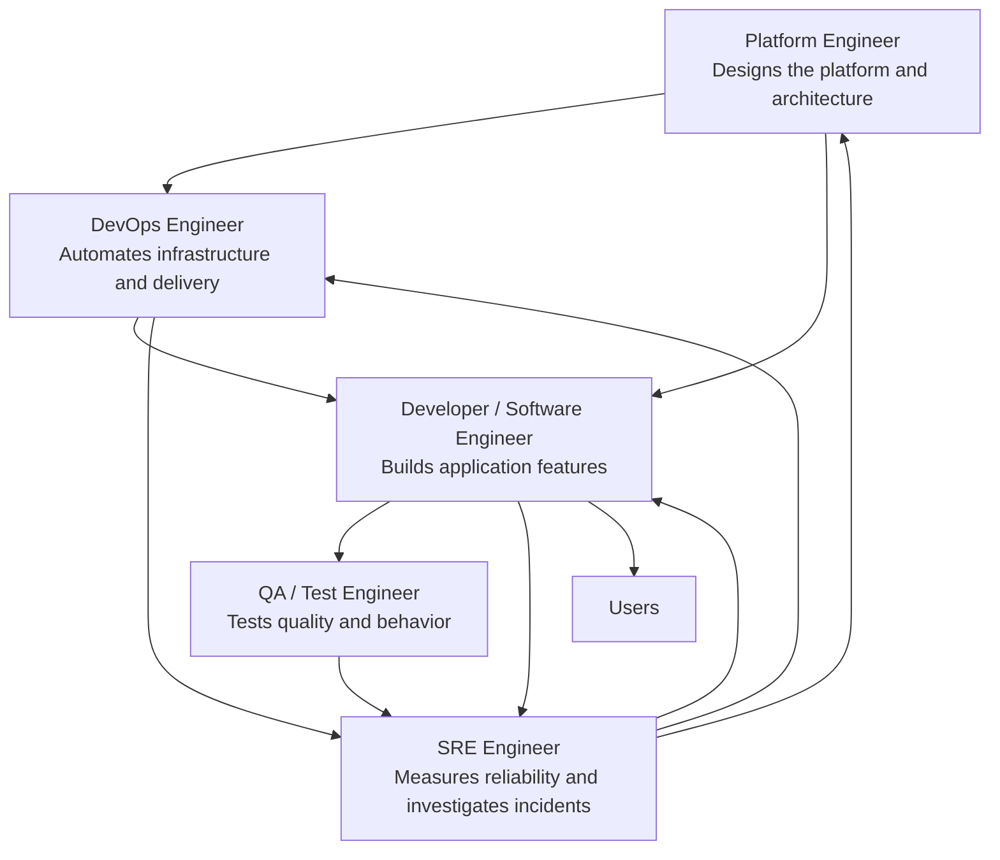
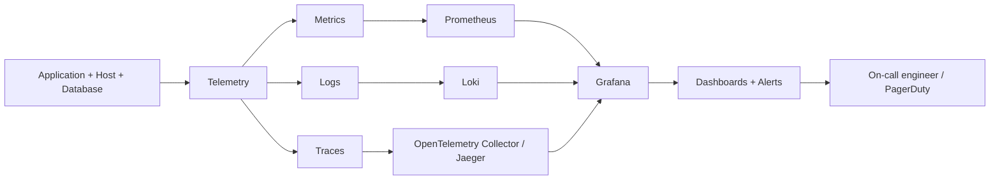
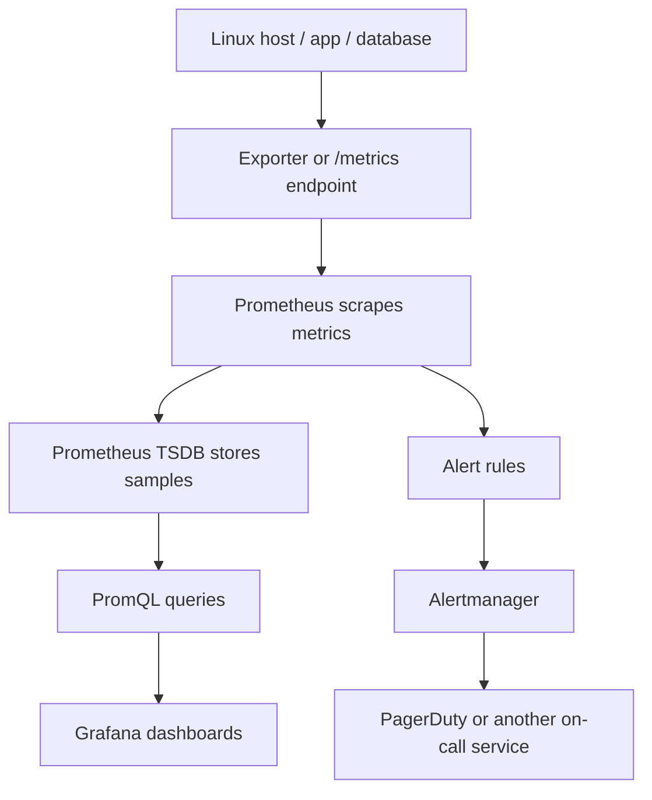
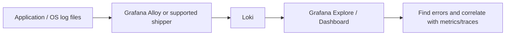
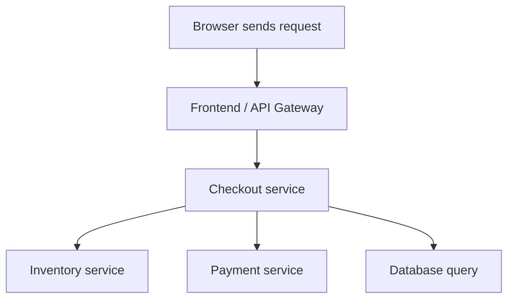
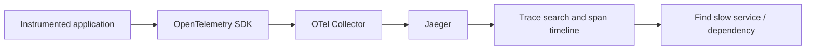
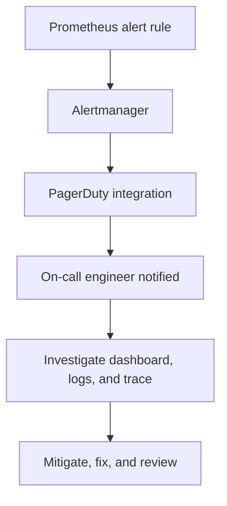

> **Goal:** Understand how DevOps, Site Reliability Engineering (SRE), Platform Engineering, Developers, and QA work together to keep applications reliable, fast, secure, and easy to operate.

---

## 1. How the engineering roles work together



### DevOps Engineer
**Main focus:** Automation, delivery pipelines, infrastructure operations, and collaboration.

Common skills and tools:
- **Scripting:** Python, Bash/Shell
- **Infrastructure as Code (IaC):** Terraform
- **Configuration management:** Ansible
- **CI/CD:** GitHub Actions, Jenkins, GitLab CI
- **Containers/orchestration:** Docker, Kubernetes
- **Cloud and operations:** AWS/Azure/GCP, Git, Linux

**Example:** Terraform creates cloud infrastructure; Ansible configures servers; a CI/CD pipeline tests and deploys the application automatically.

### SRE (Site Reliability Engineer)
**Main focus:** Reliability, availability, performance, incident response, and reducing repetitive operational work.

Typical responsibilities:
- Monitor service health and user-facing symptoms.
- Define **SLIs** (indicators), **SLOs** (objectives), and sometimes **SLAs** (formal agreements).
- Investigate incidents using metrics, logs, and traces.
- Reduce toil through automation.
- Perform capacity planning, post-incident reviews, and reliability improvements.

**Example:** Users report a slow API. The SRE checks latency and error-rate graphs, searches application logs, follows a distributed trace, identifies a slow database query, and works with developers to fix it.

### Platform Engineer
**Main focus:** Designing and maintaining a reusable internal platform that helps development teams build, deploy, and operate services safely.

Typical responsibilities:
- Design platform architecture and shared services.
- Provide reusable Kubernetes, CI/CD, identity, networking, secrets, and observability patterns.
- Create self-service templates and “golden paths.”
- Improve developer experience, security, governance, and scalability.

**Example:** Build a standard Kubernetes deployment template with logging, metrics, tracing, secrets, and alerting already configured.

### Developer and QA / Test Engineer
- **Developer / Software Engineer:** Builds and maintains application code, APIs, database queries, and business features; fixes defects revealed by production telemetry.
- **QA / Test Engineer:** Validates functionality, integration, performance, accessibility, and regression behavior before and during release.

**Important:** These roles overlap and collaborate. Platform engineers do not only design diagrams, SREs do not only watch dashboards, and DevOps engineers do not only install tools. All teams share responsibility for service quality.

---

## 2. Observability: What, Why, and How?

### What is observability?
**Observability** is the ability to understand a system's internal state by examining the outputs it produces—mainly **metrics, logs, and traces**.

It helps answer:
- Is the service healthy?
- What changed?
- Which component is slow or failing?
- How many users or requests are affected?
- Where should we investigate next?

### Why do we need it?
Without observability, an alert may say only “the application is slow.” With observability, engineers can connect a rise in latency to a specific endpoint, find related error logs, and inspect the trace to locate the slow dependency.

Benefits:
- Detect outages and degradation earlier.
- Troubleshoot faster and reduce **MTTR** (Mean Time to Restore/Recover).
- Understand performance and capacity.
- Verify whether a deployment caused a problem.
- Improve user experience and reliability.

### How does it work?



---

## 3. The three main telemetry signals

| Signal | What it tells you | Example question | Common tools |
|---|---|---|---|
| **Metrics** | Numeric measurements over time | Is CPU high? Is latency rising? | Prometheus, Grafana |
| **Logs** | Individual event records | What error occurred at 14:03? | Loki, Grafana Alloy, Fluent Bit |
| **Traces** | The path of one request across services | Which service or database call made this request slow? | OpenTelemetry, Jaeger, Grafana Tempo |

The signals complement each other:
1. **Metrics** help detect that something is wrong.
2. **Logs** explain what happened at a particular time.
3. **Traces** show where time was spent across a request's journey.

---

## 4. Metrics and Prometheus

### What are metrics?
Metrics are numeric values collected repeatedly, with timestamps and optional labels.

Examples:
- CPU utilization: `72%`
- Memory usage: `5.2 GiB`
- Request rate: `250 requests/second`
- HTTP 5xx error rate: `2%`
- API latency: `p95 = 800 ms`
- Disk I/O: read/write bytes per second and operation latency
- Network: throughput, packet drops, errors, and connections

### Why Prometheus?
**Prometheus** is an open-source monitoring and alerting system. It collects time-series metrics, commonly by scraping HTTP endpoints such as `/metrics`.

### What is TSDB?
**TSDB** means **Time-Series Database**. Prometheus stores timestamped samples for named metrics and label sets. For example:

```text
http_requests_total{service="checkout",status="200"} 18420
```

This sample means the `checkout` service's counter for HTTP status `200` has a value of `18420` at the sample timestamp. It is not a complete description of the service by itself; query its change over time to calculate rates.

Prometheus data model:
- **Metric name:** what is measured, e.g. `http_requests_total`
- **Labels:** dimensions, e.g. `service="checkout"` and `status="500"`
- **Sample:** numeric value with a timestamp
- **PromQL:** language used to query and calculate metrics

### Example PromQL queries

```promql
# CPU usage for each instance (Linux node exporter)
100 * (1 - avg by (instance) (
  rate(node_cpu_seconds_total{mode="idle"}[5m])
))

# Memory used as a percentage (Linux node exporter)
100 * (1 -
  node_memory_MemAvailable_bytes /
  node_memory_MemTotal_bytes
)

# Incoming HTTP requests per second (example metric)
sum by (service) (rate(http_requests_total[5m]))

# HTTP 5xx error percentage (example metric)
100 *
sum(rate(http_requests_total{status=~"5.."}[5m]))
/
sum(rate(http_requests_total[5m]))
```

**Note:** Metric names depend on the exporter and application instrumentation. The HTTP examples require your app to expose those metrics. Avoid unbounded/high-cardinality labels such as user IDs, request IDs, or raw URLs.

### Typical metric collection path



Useful components:
- **Node Exporter:** exports Linux host metrics such as CPU, memory, filesystem, and network statistics.
- **Prometheus:** scrapes, stores, queries, and evaluates metrics/alert rules.
- **Alertmanager:** groups, deduplicates, routes, and silences Prometheus alerts.
- **Grafana:** visualizes metrics and other telemetry in dashboards.
- **PagerDuty:** on-call incident management and notifications; it is not a metrics database.

---

## 5. Logs: application logs, system logs, and Loki

### What are logs?
Logs are timestamped records of events.

- **Application logs:** login failures, API errors, failed payments, exceptions, slow queries.
- **System logs:** operating-system events, service startup failures, kernel messages, authentication events.
- **Access logs:** HTTP method, path, response status, request duration, and similar web-server data.

Good logs should include useful context such as timestamp, service name, environment, severity, and trace/request ID where appropriate. Do not log passwords, access tokens, or sensitive personal data.

### Why use logs?
- Find the exact error and its context.
- Investigate failed requests and deployments.
- Audit important operational events.
- Correlate an error with a metric spike or trace.

### What is Loki?
**Grafana Loki** is a log aggregation system designed to store and query logs. It indexes labels/metadata rather than indexing every word in each log line in the same way as some other log systems.

### What is Promtail?
**Promtail** was a log-collection agent used to read logs and send them to Loki. **Promtail reached end of life in March 2026**; for new setups, prefer **Grafana Alloy** or another supported log shipper, following the official migration guidance. Older tutorials may still show Promtail.

### Log pipeline



Example LogQL query in Grafana Explore (labels depend on your setup):

```logql
{service_name="checkout"} |= "error"
```

This selects logs from the `checkout` service containing the text `error`, assuming that label is present.

---

## 6. Distributed tracing: OpenTelemetry and Jaeger

### What is a trace?
A **trace** represents one request's journey through an application. It contains **spans**—timed operations that may represent API handling, service-to-service calls, cache lookups, or database queries.

- **Trace:** the whole request journey.
- **Span:** one timed operation within that journey.
- **Trace ID:** identifies the overall trace.
- **Span ID:** identifies one span.
- **Parent span ID:** connects a child span to its parent.

Example request path:



A trace timeline might reveal:
- Gateway: 15 ms
- Checkout logic: 40 ms
- Inventory service: 25 ms
- Payment service: 900 ms
- Database: 20 ms

In this example, the payment call is the likely latency bottleneck.

### What is OpenTelemetry?
**OpenTelemetry (OTel)** is a vendor-neutral set of APIs, SDKs, conventions, and collectors for generating, processing, and exporting telemetry. It supports metrics, logs, and traces. It is **not itself a visualization backend**.

### What is Jaeger?
**Jaeger** is a distributed-tracing platform for collecting, storing, and visualizing traces. Applications can instrument code with OpenTelemetry and export traces to a compatible backend such as Jaeger.

### Trace pipeline



For reliable traces, propagate trace context between services and instrument important boundaries. Avoid putting secrets or sensitive user data in span attributes.

---

## 7. Grafana dashboards and alerting

### What is Grafana?
**Grafana** is an observability visualization and exploration platform. It can query supported data sources such as Prometheus and Loki, and tracing backends such as Jaeger or Tempo.

A useful service dashboard often includes:
- Request rate
- Error rate
- Latency percentiles (p50, p95, p99)
- CPU and memory
- Disk and network health
- Dependency/database latency
- Deployment markers and service-level objectives

### What is alerting?
Alerting notifies the right people when a meaningful condition occurs. Good alerts are actionable and tied to user impact or a clear operational risk—not every small CPU fluctuation.

Example alert idea:
- Trigger when the service's 5xx error rate is above 5% for 10 minutes.
- Route the alert through Alertmanager to an on-call integration such as PagerDuty.
- Include the affected service, severity, dashboard link, and runbook.



Grafana can also provide alerting for supported data sources. Choose one clear alerting path to avoid duplicate notifications.

---

## 8. Authentication, identity, and authorization

These terms are related but different. Instagram is a familiar example.

| Term | Meaning | Example |
|---|---|---|
| **Identity** | Who an entity claims to be or is represented as | Username `anand123` or a user account ID |
| **Authentication (AuthN)** | Verifying that identity | Entering a password, using a passkey, or completing MFA |
| **Authorization (AuthZ)** | Deciding what an authenticated identity is allowed to do | Permission to post, view a private profile, or administer an account |
| **Credential** | Evidence used to authenticate | Password, passkey, security key, session token |
| **Role / permission** | A set of allowed actions | `admin`, `viewer`, `read:reports` |

### Instagram-style example
1. **Identity:** You enter the username or email for your account.
2. **Authentication:** Instagram verifies the password and, if required, a second factor.
3. **Authorization:** After login, the system checks what the account can access or change.

If a username or password is incorrect, authentication fails. The username is not the password: the username identifies the account; the password is one credential used to prove control of it. A successful login does not automatically grant administrator permissions.

**Security note:** Never put real passwords, API keys, session cookies, or private tokens into README files, screenshots, logs, or Git repositories.

---

## 9. Example: Investigating a slow application

Suppose users say that the checkout page takes 4 seconds to load.

1. **Detect with metrics:** Grafana shows p95 latency rising from 300 ms to 4 s and the error rate increasing.
2. **Scope the issue:** Prometheus metrics show whether the problem affects all services or only checkout.
3. **Inspect logs:** Search Loki for checkout errors and slow database messages around the incident time.
4. **Follow the trace:** Open the trace in Jaeger and identify which span consumes most of the 4 seconds.
5. **Mitigate:** Roll back a faulty deployment, scale a constrained service, or disable a problematic dependency if the runbook allows it.
6. **Fix:** Work with the developer/platform team to resolve the underlying issue.
7. **Verify:** Check latency, errors, and user impact after the fix.
8. **Learn:** Write a blameless post-incident review and add tests, dashboards, alerts, or automation to prevent recurrence.

---

## 10. Quick revision

- **DevOps:** Automates build, test, deployment, infrastructure, and operations.
- **SRE:** Focuses on measurable reliability, incident response, SLOs, and toil reduction.
- **Platform Engineering:** Builds reusable, secure internal platforms and developer self-service.
- **Metrics:** Numeric trends; Prometheus stores and queries time-series data in its TSDB.
- **Logs:** Event details; Loki stores and queries logs.
- **Traces:** Request journey and timing; OpenTelemetry instruments/exports telemetry and Jaeger visualizes traces.
- **Grafana:** Dashboards and exploration across telemetry sources.
- **Alertmanager:** Routes and groups Prometheus alerts.
- **PagerDuty:** On-call notification and incident coordination.
- **Identity:** Who the account is.
- **Authentication:** Prove the identity.
- **Authorization:** Decide what the identity can do.

### Remember
**Metrics tell you that something may be wrong. Logs help explain what happened. Traces help show where a request spent its time.** Use all three together to troubleshoot effectively.

---

## 11. Official documentation

- Prometheus: https://prometheus.io/docs/introduction/overview/
- PromQL basics: https://prometheus.io/docs/prometheus/latest/querying/basics/
- Grafana: https://grafana.com/docs/grafana/latest/
- Loki: https://grafana.com/docs/loki/latest/
- Grafana Alloy: https://grafana.com/docs/alloy/latest/
- OpenTelemetry: https://opentelemetry.io/docs/
- Jaeger: https://www.jaegertracing.io/docs/
- Google SRE books: https://sre.google/books/
- PagerDuty documentation: https://support.pagerduty.com/
"""
path = Path("/mnt/data/SRE_Observability_Notes_README.md")
path.write_text(content, encoding="utf-8")
print(f"Created: {path}")
print(f"Size: {path.stat().st_size} bytes")
